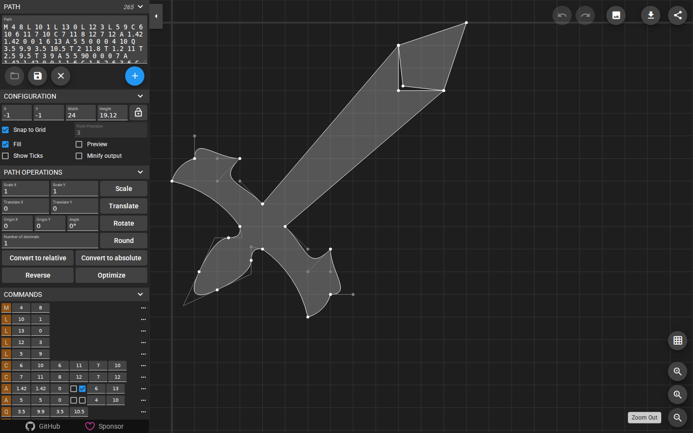

# SvgPathEditor — React port

A faithful React port of [Yqnn's SvgPathEditor](https://github.com/Yqnn/svg-path-editor): an online editor to create and manipulate SVG paths.

The app is built with [Vite](https://vite.dev/), [React 19](https://react.dev/), and [MUI](https://mui.com/) (replacing Angular Material). The original dark Material 2 design, layout, animations, shortcuts, PWA support, and behaviour are preserved.



## How to Use

##### Basic:

- Paste or edit the raw path in the **path** field
- Click on **+** to add a new command to the path, select a type, then click on the destination
- Move points with drag and drop
- Click on a point, then on the **...** button to insert a command right after the selected one, to remove it, or to change its type

##### Commands panel:

- Click on the command type to toggle between relative and absolute coordinates
- Relative command types are **purple**, absolute are **orange**
- Click on **...** then **Delete** to delete a command
- Click on **...** then **Insert after** to insert a new command right after the selected one
- Click on **...** then **Convert to** to convert the selected command to a new type
- Click on **...** then **Start Path From Here** to reorder the path so that the selected command becomes first
- Click on **...** then **Start Subpath From Here** to reorder the path so that the selected command becomes first in its subpath
- Click on **...** then **Reverse Subpath** to reverse the command order in the subpath of the selected command

##### ViewBox:

- Use mouse wheel, or click **Zoom in** and **Zoom out** to zoom in/out
- Use drag & drop to move the viewBox
- Click on **Zoom to Fit** to automatically set the viewBox depending on current path
- ViewBox can also be set manually with the **x**, **y**, **width** and **height** fields

##### Path operations:

- Scale the full path with the **Scale** button
- Translate the full path with the **Translate** button
- Rotate the full path with the **Rotate** button
- Round all coordinates of the current path with the **Round** button
- Convert all commands to relative or absolute coordinates with **Convert to relative** or **Convert to absolute** button
- Reverse the command order with the _Reverse_ button
- Minimise the path length with the _Optimize_ button

##### Images:

- Toggle image management mode with the image button
- Import images and position/resize them on the canvas
- Change opacity, preserve aspect ratio, or delete an image from its **...** menu

##### Shortcuts:

- Press **m**, **l**, **v**, **h**, **c**, **s**, **q**, **t**, **a** or **z** to insert a command after the selected one
- Press **shift** + **m**, **l**, **v**, **h**, **c**, **s**, **q**, **t**, **a** or **z** to convert selected command to a new type
- Press **echap** to delete the command being created, or the undo the current dragging operation
- Press **delete** or **backspace** to delete the selected command
- Press **ctrl** + **z** or **cmd** + **z** to undo
- Press **ctrl** + **shift** + **z** or **cmd** + **shift** + **z** to redo
- Press **ctrl** while dragging to ignore `snap to grid` constraint

## Library

The original `svg-path-editor-lib` package is preserved verbatim in [`src/lib`](./src/lib), including its tests and `package.json`.

It powers the app from the same location as before, and can still be published independently:

```bash
npm run build-lib
cd src/lib && npm publish
```

The library exposes `SvgPath`, `SvgItem`, `PathParser`, `optimizePath`, `reversePath`, and `changePathOrigin`.

## Running Locally

##### Requirements

- [Node.js](https://nodejs.org/) v20.19 or higher.

##### Dependencies

Run `npm ci` (or `npm install`) to retrieve all dependencies.

##### Development server

```bash
npm start
```

Navigate to `http://localhost:5173/`. The app reloads automatically when source files change.

##### Build

```bash
npm run build
```

Build artifacts are written to `dist/`. The production build includes a generated service worker and web app manifest (via `vite-plugin-pwa`). Roboto and Material Icons are bundled and precached, so the app remains fully styled and functional offline after installation.

##### Tests

```bash
npm test
```

This runs the ported `svg-path-editor-lib` test suite plus unit tests for the React app's state, storage, formatting, and path rules.

##### Linting and formatting

```bash
npm run lint
npm run format
npm run format:check
```

### Docker

```bash
docker compose up --build
```

The dev server is exposed on `http://localhost:5173/`.

## Performance

Bundle size and startup/interaction benchmarks against the compiled Angular 17 and Angular 22
builds are documented in [`doc/performance.md`](./doc/performance.md).

## Deployment (gh-pages)

The build pipeline publishes the contents of `dist/` to the `gh-pages` branch.

- `npm run build:gh` builds with the `/svg-path-editor-react/` base path used by GitHub Pages.
- `npm run deploy:gh-pages` builds, clones the target `gh-pages` branch, replaces its contents, commits, and (after confirmation) pushes it. By default it targets `https://github.com/Yqnn/svg-path-editor-react.git`; override it with `GH_PAGES_REPO` (and optionally `GH_PAGES_BASE`, `GH_PAGES_BRANCH`, `GH_PAGES_YES=1`).
- `.github/workflows/deploy-gh-pages.yml` runs the tests, builds the app, and publishes `dist/` to the current repository's `gh-pages` branch on every push to `main`/`master`.

## Port notes

- Rendering uses SVG directly, with the same grid, ticks, points, control handles, image editing overlay, and preview mode as the Angular app.
- All dialogs (open/save, export, share, import, image import) use MUI components and reproduce the original layouts and idle/enter/leave animations.
- Configuration is persisted in `localStorage` with the original `SaveDecorator.Config.*` / `SaveDecorator.ExportConfig.*` keys and the same `storedPaths` format, so behaviour matches the original app.
- Shared links (`#P=...`), undo/redo, drag & drop, snapping, pinch zoom, and keyboard navigation are implemented.
- The app is client-rendered only (no SSR).

## Special Thanks

Many thanks to our sponsors 🙇 !

[@riovir](https://github.com/riovir), [@miniBill](https://github.com/miniBill), [@GitHub](https://github.com/GitHub), [@alexandernst](https://github.com/alexandernst), [@Filimoa](https://github.com/Filimoa), [@agrogers](https://github.com/agrogers), [@MilesTails01](https://github.com/MilesTails01), [@robetus](https://github.com/robetus), [@adcar](https://github.com/adcar), [@getsentry](https://github.com/getsentry), [@simplicitywebdesign](https://github.com/simplicitywebdesign), [@PassPilot](https://github.com/PassPilot), [@zeroin](https://github.com/zeroin), [@jholmes-dev](https://github.com/jholmes-dev), [@sh-csg](https://github.com/sh-csg), [@MarcoRudin](https://github.com/MarcoRudin), [@Oddpod](https://github.com/Oddpod), [@roboflow](https://github.com/roboflow), [@lasaldan](https://github.com/lasaldan), [@stevekerrick](https://github.com/stevekerrick), [@toth-istvan-zoltan](https://github.com/toth-istvan-zoltan), [@PBI-DataVizzle](https://github.com/PBI-DataVizzle), [@gucr](https://github.com/gucr), [@Guiorgy](https://github.com/Guiorgy), [@LeaVerou](https://github.com/LeaVerou), [@miham-aib](https://github.com/miham-aib), [@BarryCap](https://github.com/BarryCap), [@orangeman1066](https://github.com/orangeman1066), [@samzmann](https://github.com/samzmann), [@farin](https://github.com/farin), [@gorenje](https://github.com/gorenje)

## License

AGPL-3.0-only — see [LICENSE](./LICENSE).
